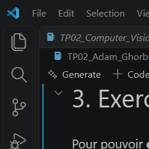
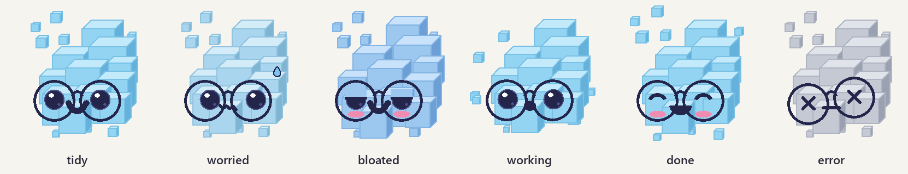

<p align="center">
  
</p>

<h1 align="center">Memo</h1>

<p align="center">
  A tiny desktop buddy that keeps your markdown memory notes tidy.<br>
  One look tells you how your notes are doing. One click cleans them up.
</p>

<p align="center">
  
  
  
</p>

## Why

If you use an AI coding assistant, you probably keep a folder of notes so it
remembers your projects between sessions. Those notes rot quietly. Session files
pile up, one subject gets split across three notes, history sections grow
forever, links break. Nobody cleans them until the assistant starts loading a
wall of stale text.

Memo sits in the corner of your screen and shows the state of that folder on
its face. When it starts sweating, click it.

## Meet the moods

<p align="center">
  
</p>

| Mood | What it means |
|---|---|
| **tidy** | Nothing to fix. Memo breathes slowly and blinks now and then. |
| **worried** | Warnings: a note over the word limit, a broken link. A sweat drop slides down. |
| **bloated** | Real problems: leftover session files, almost empty notes, a subject split over too many notes. |
| **working** | Munching through your notes after a click. |
| **done** | Finished. A bubble tells you what changed. |
| **error** | Something failed. The bubble says what. |

## What a click does

Memo only makes changes that need no judgment:

* **Long notes get lighter.** The oldest lines of a note's `## History` section
  move into `<Subject> - Archive.md`, and a link to the archive stays at the
  bottom. The newest line always stays put.
* **Missing headings get added**, so every subject note has the same shape.
* **Almost empty notes and empty folders are removed.**
* **Links to deleted notes are cleaned up.** Delete an old note and every
  `[[link]]` to it turns back into plain text, so the words stay and nothing
  points at a missing note. An "Older history" line whose archive you deleted is
  removed.

Anything that needs real rewriting (merging two notes, condensing a long
summary) is listed in the bubble and never touched.

**Nothing is lost.** Before every change Memo saves a backup zip in
`<your notes>/.memo/backups/`, and *Undo last tidy* puts everything back.

## Quick start

You need Python 3.11 or newer. That is all: Memo uses only the standard library
(only the optional `linko3d` skin needs Pillow).

```bash
git clone https://github.com/ademghorbel/memo.git
cd memo
pythonw -m memo widget --vault "path/to/your/notes"
```

On macOS and Linux use `python3` instead of `pythonw`. Without `--vault`, Memo
looks at `$MEMO_VAULT`, then `~/ClaudeVault`.

### Using the buddy

| Action | Result |
|---|---|
| Click | Tidy up, check again, show what happened |
| Drag | Move Memo anywhere on the screen |
| Right click | *Tidy up*, *Check only*, *What's wrong?*, *Undo last tidy*, *Open vault folder*, *Quit* |
| Esc | Quit |

Memo checks again on its own every 10 minutes. Change that with `--every 30`,
or `--every 0` to check only when you click.

### Skins

| Skin | Look | Needs |
|---|---|---|
| `memo` (default) | the emo face, drawn with canvas shapes | nothing |
| `linko` | CS Linko, the IEEE Computer Society mascot, drawn as a cloud of cubes with round glasses | nothing |
| `linko3d` | a 3D render of Linko's head, animated per mood (bounce, shake, orbiting cubes, sparkles, grey on error) | [Pillow](https://pypi.org/project/pillow/) and the render PNG, path in `$MEMO_LINKO_IMAGE` |

```bash
pythonw -m memo widget --skin linko
```

Set `$MEMO_SKIN` to pick a skin without the flag. The Linko render is not
shipped in this repo.

## Command line

Everything the buddy does also works in a terminal:

```bash
python -m memo check            # report only, changes nothing
python -m memo check --json     # the same, for scripts
python -m memo fix --dry-run    # show what a tidy would change
python -m memo fix              # tidy (backup first)
python -m memo undo             # put the last tidy back
```

Example:

```text
( o_o;)  worried
16 notes, 5522 words, 37.2 KB  (C:\Users\you\ClaudeVault)
  [warning] oversize-note  Work.md: 675 words, limit is 600.
  [info] missing-section  Laptop.md: No section: History.
```

`check` exits with code 1 when there are problems, so it also fits in a hook or
a CI job.

## The note layout Memo expects

Memo works best with one note per subject, shaped like this:

```markdown
# Subject

A short paragraph: what it is and where it lives.

## Current state
## Decisions
## Open items / next
## History
* 2026-10-21: one line per session, newest first.
```

plus a rolling `Last Session.md`. Thresholds are flags: `--max-words`
(default 600) and `--max-notes` per subject (default 2, the note and its archive).

### Every check

| Code | Level | What it catches |
|---|---|---|
| `dated-file` | problem | `YYYY-MM-DD*.md` session files that should be merged |
| `stub-file` | problem | notes with almost no content |
| `too-many-notes` | problem | one subject spread over too many notes |
| `oversize-note` | warning | a note over the word limit |
| `broken-link` | warning | a `[[link]]` to a note that does not exist |
| `no-last-session` | warning | the rolling last session note is missing |
| `missing-section` | info | a subject note without the expected headings |

Archive notes are allowed to be short or long, so the size checks skip them.

## How it is built

```text
memo/
  checker.py     reads the notes, returns a Report (findings, stats, mood)
  fixer.py       the safe fixes, backups and undo
  widget/
    face.py      draws the face with canvas shapes, no image files
    linko.py     the Linko skin, same drawing contract
    linko3d.py   the Linko 3D skin (optional, Pillow)
    app.py       the window: click, drag, menu, bubble
    text.py      turns a Report into the bubble's sentences
  __main__.py    the command line
```

The checker is the single source of truth: the terminal, the buddy and any
future front end all read the same Report, so the face can never disagree with
the facts. A new skin is just another module with the same `draw(canvas, state,
t, k)` function plus `SIZE`, `STATES` and `INK`.

## Tests

```bash
python -m unittest discover tests
```

The tests build their own throwaway vault, so they never touch your notes.

## Roadmap

* **Compact with AI (optional):** let Claude condense long summaries and merge
  split notes, always showing the change and asking first.
* Start with the computer, remember the position, a config file.
* More skins.

Ideas and pull requests are welcome.

## Licence

[MIT](LICENSE)
